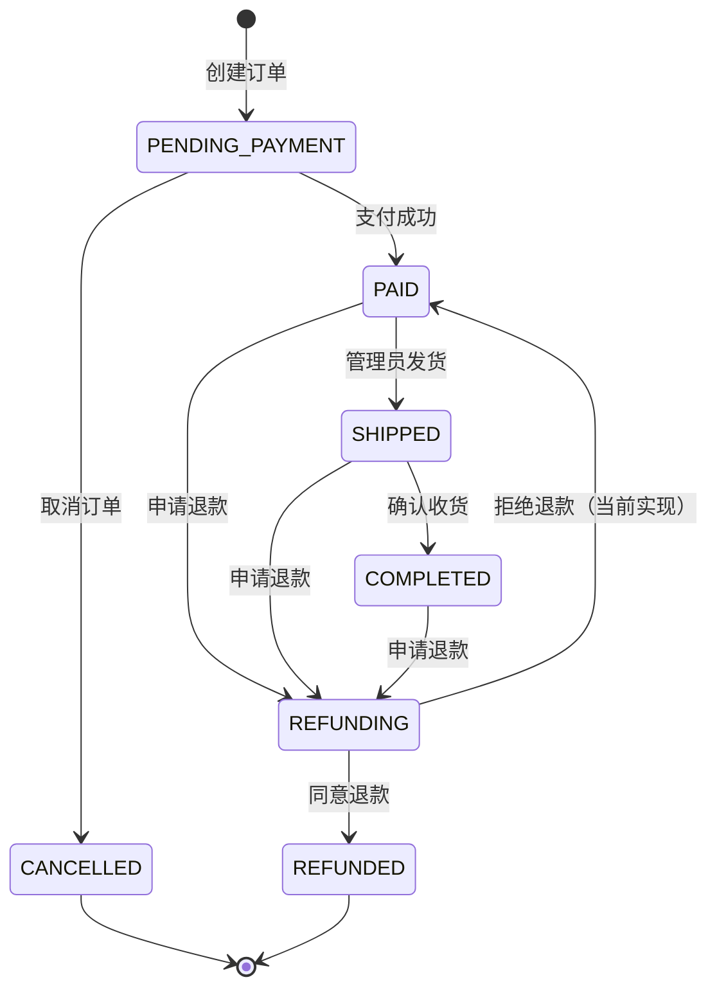

# 1. 状态列表

| 状态 ID | 状态名称 | 含义 | 终态 | 说明 |
|---|---|---|---|---|
| `PENDING_PAYMENT` | 待支付 | 订单已创建，尚未支付 | 否 | 创建订单后的初始状态 |
| `PAID` | 已支付 | 支付成功，等待发货 | 否 | 支付成功时写入 `paid_at` |
| `PENDING_SHIPMENT` | 待发货 | 已支付待发货 | 否 | 代码多处引用，但**从未被赋值**，实际不可达 |
| `SHIPPED` | 已发货 | 管理员已录入物流 | 否 | 写入 `shipped_at` 和 `shipments` |
| `COMPLETED` | 已完成 | 用户确认收货 | 否 | 写入 `completed_at`；可因退款进入 `REFUNDING` |
| `CANCELLED` | 已取消 | 待支付订单被取消 | 是 | 写入 `cancelled_at` |
| `REFUNDING` | 退款中 | 已申请退款，等待审核 | 否 | 由售后模块写入（本批未完整覆盖） |
| `REFUNDED` | 已退款 | 退款审核通过 | 是 | 库存恢复（见售后模块） |

状态中文映射来源：`Minishop/backend/app/api/common.py#L114-L125`。

# 2. 状态转换

| 当前状态 | 触发事件 | 前置条件 | 目标状态 | 不允许的条件 |
|---|---|---|---|---|
| （无） | 创建订单 | 校验通过，地址必填 | `PENDING_PAYMENT` | 商品下架、SKU 失效、库存不足、地址无效、券无效 |
| `PENDING_PAYMENT` | 支付成功 | 订单属于当前用户；支付单存在 | `PAID` | 订单已取消；订单已是支付后状态 |
| `PENDING_PAYMENT` | 取消订单 | 订单属于当前用户 | `CANCELLED` | 非待支付状态；非本人（返回 404） |
| `PENDING_PAYMENT` | 支付失败 | 支付单存在、订单属于当前用户 | `PENDING_PAYMENT` | 非待支付状态（返回 409） |
| `PAID` | 管理员发货 | 操作者为管理员；填写物流信息 | `SHIPPED` | 非已支付/待发货；非管理员 |
| `PENDING_SHIPMENT` | 管理员发货 | 同上 | `SHIPPED` | 实际不可达（状态从未被赋值） |
| `SHIPPED` | 用户确认收货 | 订单属于当前用户 | `COMPLETED` | 非已发货；非本人（返回 404） |
| `PAID` / `SHIPPED` / `COMPLETED` | 申请退款 | 订单属于当前用户；无历史退款记录 | `REFUNDING` | 待支付、已取消、退款中、已退款；已有退款记录 |
| `REFUNDING` | 管理员同意退款 | 退款记录为 `PENDING` | `REFUNDED` | 非待审核；重复处理 |
| `REFUNDING` | 管理员拒绝退款 | 必须填写拒绝原因 | `PAID` | 非待审核；未填原因（400） |



# 3. 状态不变量

1. `orders.user_id` 创建后不变，订单只属于一个用户。
2. `total_amount`、`discount_amount`、`pay_amount` 创建后不再被业务代码修改。
3. `paid_at` 只在支付成功时写入；`shipped_at` 只在发货时写入；`completed_at` 只在确认收货时写入；`cancelled_at` 只在取消时写入。
4. 订单使用优惠券时，用户券在订单创建时置 `USED`；取消订单时恢复 `UNUSED`；**退款流程不恢复优惠券**。
5. 库存只在支付成功时扣减；只在退款成功时恢复（见售后模块）。
6. `SHIPPED`、`COMPLETED` 状态应存在对应 `shipments` 记录；确认收货后物流单为 `DELIVERED`。
7. `CANCELLED`、`REFUNDED` 为终态，没有出边；`COMPLETED` 可因退款进入 `REFUNDING`，不是终态。
8. `PENDING_SHIPMENT` 在数据字典中存在，但没有任何写入路径，不能作为当前有效状态使用。

## 已确认决策（2026-11-11）

- **Q-02**：不引入库存预占；超卖为 Demo 已知限制，支付时库存不足仍成功并以 `max(stock-qty,0)` 截断。
- **Q-04**：退款被拒应恢复退款前状态（`PAID/SHIPPED/COMPLETED`）；当前统一回 `PAID` 属缺陷，修复需增加 `pre_refund_status` 快照。
- **Q-08**：`PENDING_SHIPMENT` 未启用，不纳入当前有效状态机。
- **Q-12**：当前无订单超时自动取消。

# 4. 并发与重复操作约束

| 操作 | 重复/并发行为 |
|---|---|
| 创建订单 | 无幂等键；重复提交生成多张订单 |
| 创建支付单 | 已有 `PENDING` 支付单时复用；否则新建；`FAILED` 后可再建 |
| 支付成功 | 依赖订单状态判重；并发下缺少行锁，理论上可能重复扣库存 |
| 支付失败 | 仅待支付可执行；重复执行时订单状态未变，仍可再次置 `FAILED` |
| 取消订单 | 第二次返回 409（状态已非待支付） |
| 发货 | 第二次返回 409（状态已 `SHIPPED`） |
| 确认收货 | 第二次返回 409（状态已 `COMPLETED`） |
| 申请退款 | 同一订单只允许一条退款记录；已拒绝也不能再次申请 |
| 退款审核 | 非 `PENDING` 再次审核返回 409 |

# 5. 状态查询与验证方式

## 5.1 接口

```http
GET /api/orders/{order_id}
Authorization: Bearer <token>
```

响应关键字段：`status`、`status_cn`、`paid_at`、`shipped_at`、`completed_at`、`cancelled_at`、`payment`、`shipment`、`refund`。

## 5.2 数据库

```sql
SELECT id, order_no, status, total_amount, pay_amount, paid_at, shipped_at, completed_at, cancelled_at
FROM orders WHERE id = ?;

SELECT id, order_id, status, payment_no, amount, paid_at FROM payments WHERE order_id = ?;
SELECT id, order_id, company, tracking_number, status, shipped_at FROM shipments WHERE order_id = ?;
SELECT id, order_id, status, amount, reason, reject_reason FROM refunds WHERE order_id = ?;
```

## 5.3 派生观察

- 库存与销量：`product_skus.stock`、`products.stock`、`products.sales`
- 优惠券：`user_coupons.status`、`used_order_id`、`used_at`
- 库存日志：`inventory_logs` 按 `sku_id` 查询
- 消息：`messages` 按 `user_id` 查询

# 6. 来源与未决问题

## 来源

- 状态字段：`Minishop/backend/app/models/models.py#L171-L193`
- 创建订单：`Minishop/backend/app/api/orders.py#L116-L170`
- 取消/确认：`Minishop/backend/app/api/orders.py#L223-L260`
- 支付：`Minishop/backend/app/api/payments.py#L77-L118`
- 发货：`Minishop/backend/app/api/admin.py#L156-L178`
- 退款申请：`Minishop/backend/app/api/refunds.py#L14-L41`
- 退款审核：`Minishop/backend/app/api/admin.py#L205-L245`

## 未决问题

1. `PENDING_SHIPMENT` 应启用还是删除？
2. 退款被拒绝后应恢复到退款前状态（`PAID`/`SHIPPED`/`COMPLETED`），还是统一 `PAID`？当前实现统一 `PAID`，会丢失已发货/已完成事实。
3. 是否需要订单超时自动取消（`PENDING_PAYMENT → CANCELLED`）？
4. 是否需要库存预占状态（下单锁定库存）？
5. 支付成功并发是否需要行锁或幂等键？
6. 退款成功后优惠券是否应归还？
7. `REFUNDING` 是否允许发货/确认收货？（当前发货只允许 `PAID/PENDING_SHIPMENT`，确认只允许 `SHIPPED`）


# 本次授权技术复核适用性

核对订单、支付、发货和退款路由；COMPLETED 有退款出边，修正 Mermaid 终态矛盾；退款拒绝当前回 PAID，目标恢复原状态。

本次结论基于冻结快照与既有决策，当前实现中的限制不代表目标规格；已决策但未实施的项目仍按治理台账单独跟踪。复核者为用户授权的 AI 代理，非新增人工签署。

---

## 复核记录（人工复核，2026-11-11）

- **审核结论**：修改后通过
- **审核人**：平台设计者（产品负责人）
- **审核日期**：2026-11-11
- **审核意见**：PENDING_SHIPMENT 已正确标注不可达、退款拒绝回 PAID 已写明为当前实现并列入未决问题；但不变量 7 与状态表把 COMPLETED 标为"终态、无出边"，与同文档转换表 COMPLETED→REFUNDING 自相矛盾（refunds.py:21 仅拦截 PENDING_PAYMENT/CANCELLED/REFUNDING/REFUNDED，已完成订单确可退款，设计者已复核）。
- **复核备注**：修订要求：COMPLETED 改为非终态（终态仅 CANCELLED/REFUNDED）；未决问题 2 按 Q-04 决策改写为"应恢复退款前状态，当前统一回 PAID 属缺陷待修复"；未决问题 1/3/4 分别按 Q-08/Q-12/Q-02 决策补记结论。
- **回写说明**：2026-11-12 已按复核意见回写；仍为 in_review，待复审后置 approved。
